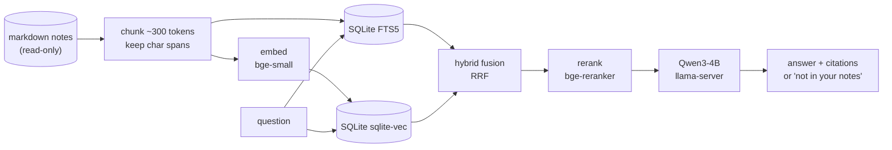

# NoteCabinet

**Privacy-focused notes assistant with fully on-device AI.** Ask questions about your markdown notes and get answers with citations, or turn a messy page into a clean, structured view. Nothing leaves your machine.

> **Status:** work in progress. Indexing and Ask work end to end (M0–M2); the evaluation (M3) is next. See the [roadmap](#roadmap).

## What it does

**Ask**: answer questions about your notes, with every claim linked to the exact note and character span it came from. When the answer isn't in your notes, it says so instead of guessing.

```
$ notecabinet ask "what did MW show me how to do on GCLU?"
MW showed you how to profile PyTorch code efficiently on GCLU by wrapping the region of interest in the
built-in profiler, focusing only on short windows to avoid large, useless traces, [...] [4].

[4] 2025-10-21-gclu-pytorch-profiling.md:94-1205  ## what happened - Marcus Webb sat down w/ me & showed how to profile PyTorch code efficie...

$ notecabinet ask "what is my GPA this quarter?"
Not in your notes (no relevant notes found).
```
*(real output on the benchmark notes; the first answer is shortened at `[...]`)*

**Organize page**: turn one shorthand-heavy page into sections, action items and open questions, without dropping or inventing facts. Personal shorthand ("mtg w/ PATL re DSEC") is resolved by retrieving how you've used it in your *other* notes; anything still unclear is marked uncertain, never guessed. The original note is never modified.

## Why

Personal notes are private and full of shorthand only you understand. Cloud assistants need your notes to leave your machine, and generic models don't know who "PATL" is. NoteCabinet keeps everything local and treats your plain markdown files as the source of truth.

## Design decisions

1. **Raw markdown files are the source of truth.** The app never modifies them.
2. **AI output is a derived view.** Organize results are computed on request and never stored.
3. **One SQLite file holds the whole index**: FTS5 for keywords and sqlite-vec for vectors. It can be deleted and rebuilt from the notes at any time.
4. **All inference at runtime is local**: llama.cpp for the LLM, local embedding and reranker models. The app's only network call is to the local llama-server.
5. **Every answer and every organized line links back to its source** (note path + character span).

## Architecture



| Piece | Choice |
|---|---|
| LLM | Qwen3-4B-Instruct-2507 (Q4_K_M) on `llama-server` (llama.cpp, CUDA) |
| Embeddings | `BAAI/bge-small-en-v1.5` |
| Reranker | `BAAI/bge-reranker-base` (cross-encoder) |
| Index | SQLite: FTS5 (BM25) + `sqlite-vec` |
| Orchestration | LangChain core: custom retrievers over the SQLite index, LCEL chains |
| Structured output | llama-server JSON-schema constrained decoding |
| API + UI | FastAPI + one static HTML page (no CDN) |

Target hardware: a laptop RTX 4060 (8 GB VRAM) runs the LLM, embedder and reranker together.

## Evaluation

The point of this project is measuring it, not just building it. Retrieval, answers and abstention are scored on a synthetic benchmark with known ground truth.

**Ask**, reported on a held-out test split:
- **Fact-level recall@5**: did retrieval surface a note containing every fact the question needs? Plus MRR.
- **Answer correctness and faithfulness**: graded by an LLM judge whose agreement with hand grades is reported.
- **Abstention precision / recall** on unanswerable questions.
- **Ablation**: BM25 vs. dense vs. hybrid vs. hybrid + rerank, broken down by question type.
- **Latency**: p50/p95 for retrieval, reranking and generation.

**Organize**, with vs. without retrieval:
- **Coverage** of the page's ground-truth facts, **hallucination rate**, and **shorthand accuracy**.

Every eval run writes a timestamped folder under `results/` with its full config (models, thresholds, git commit, data hash) so each number is reproducible. Results will appear here once M3/M4 are complete.

## Benchmark dataset

All data is synthetic, built around a world bible for one fictional grad-student quarter.

| | |
|---|---|
| [`data/bible.md`](data/bible.md) | Ground truth: 102 dated facts (9 change over time) and a 22-entry personal shorthand glossary |
| [`data/notes/`](data/notes/) | 100 messy notes (lectures, meetings, project logs, todos, readings, ideas) |
| [`data/eval/qa.jsonl`](data/eval/qa.jsonl) | 61 hand-checked questions: single-fact, multi-fact, temporal, shorthand and unanswerable; 10 dev / 51 test |
| [`data/eval/organize/`](data/eval/organize/) | 20 messy pages with their clean facts and shorthand as ground truth (+3 dev pages) |

How it was made: the bible was drafted with Gemini and then edited by hand to fix inconsistencies. Notes, questions and pages were generated from it with Claude. Glossary abbreviations were substituted by code (so the shorthand ground truth is exact), and a seeded noise pass added typos and dropped punctuation without touching dates, numbers or names. Every question was validated in code and then checked by hand. Claude is used only offline, for the dataset and as the eval judge; the app itself never calls it. The generation scripts are not included in this repository, so evals are reproducible from the committed data.

## Roadmap

| | Milestone | Status |
|---|---|---|
| M0 | Synthetic benchmark dataset | ✅ |
| M1 | Indexing: chunking with exact spans, SQLite FTS5 + sqlite-vec, incremental re-index | ✅ |
| M2 | Retrieval (BM25 / dense / hybrid / rerank) + Ask with citations and abstention | ✅ |
| M3 | Ask evaluation: recall, correctness, abstention, ablation, latency | |
| M4 | Organize page + evaluation, with vs. without retrieval | |
| M5 | Demo UI, results, write-up | |

Beyond the mini version: sync across devices, Android client, and tiered inference across devices.

## Install

Requirements:
- Linux, Python 3.10+
- [`llama-server`](https://github.com/ggml-org/llama.cpp) from llama.cpp, installed separately (a CUDA build for GPU speed)
- An NVIDIA GPU is recommended. The embedder and reranker fall back to the CPU; the LLM is slow on CPU.

```bash
pipx install git+https://github.com/shiveshsrivastava/NoteCabinet
notecabinet download-models --with-llm     # one-time: embedder + reranker, plus the Qwen GGUF
```

`pipx` installs PyTorch from PyPI, which includes its CUDA libraries (several GB). The models are pinned to exact
revisions; after this download the app loads them offline and never touches the network again.

Start the local LLM (keep it running in another terminal):

```bash
llama-server -m ~/.local/share/notecabinet/models/Qwen3-4B-Instruct-2507-Q4_K_M.gguf -ngl 99 -c 8192 --parallel 1 --port 8080
```

`--parallel 1` plus temperature 0 and a fixed seed makes answers repeatable. Point NoteCabinet at a different
server with `LLM_URL` (default `http://localhost:8080`).

## Usage

```bash
notecabinet --help
notecabinet --version
```

**`notecabinet download-models [--with-llm] [--llm-dir DIR]`**: one-time download of the pinned embedder and
reranker into the Hugging Face cache; `--with-llm` also fetches the GGUF for llama-server
(default folder `~/.local/share/notecabinet/models`).

**`notecabinet index [NOTES_DIR] [--full]`**: build or update the index. Give the notes folder the first time;
later runs remember it. Only changed notes are re-embedded; `--full` rebuilds from scratch.

```
$ notecabinet index data/notes
full (no index yet): 100 notes, 139 chunks in 6.9s -> .../notecabinet/notes.db
$ notecabinet index
incremental: 100 notes (0 new, 0 changed, 0 deleted, 100 unchanged), 0 chunks embedded in 0.0s -> .../notecabinet/notes.db
```
*(real output on the benchmark notes; the index path is shortened)*

The index is one SQLite file at `$NOTECABINET_INDEX`, else `$XDG_DATA_HOME/notecabinet/notes.db`
(`~/.local/share/notecabinet/notes.db`). Delete it any time; it is rebuilt from your notes. Indexing only reads
notes, never writes them. Changing the chunker or embedding model triggers a full rebuild automatically.

**`notecabinet ask "QUESTION" [--retriever bm25|dense|hybrid|hybrid+rerank] [--json]`**: answer from your notes
with `[n]` citations (note path and character span), or say it isn't in your notes. The default retriever is
`hybrid+rerank`; `--json` prints the full result, including the retrieved chunks, scores and per-stage timings.

**`notecabinet serve [--host 127.0.0.1] [--port 8000]`**: start the HTTP API (interactive docs at `/docs`).

```bash
curl -s localhost:8000/ask -H 'content-type: application/json' -d '{"question": "where did I print the AutoNav poster?"}'
curl -s localhost:8000/notes                                   # list indexed notes
curl -s localhost:8000/notes/2025-12-01-anav-poster-printed.md # raw text; citation spans index into "raw"
```

## Development and tests

```bash
git clone https://github.com/shiveshsrivastava/NoteCabinet && cd NoteCabinet
pip install -e ".[dev]"            # or: uv sync --extra dev
notecabinet download-models        # the tests need the embedder + reranker weights
ruff check .
pytest                             # whole suite; no llama-server needed (LLM calls are faked)
pytest -m "not models"             # only the tests that don't need model weights
python scripts/smoke_test.py       # environment check: sqlite-vec, FTS5, CUDA, llama-server
```

Tests that need model weights are marked `models` and are skipped, with a reason, if the weights are missing.
CI runs ruff and the full suite on Python 3.10–3.13 ([`.github/workflows/ci.yml`](.github/workflows/ci.yml)).

To run against the benchmark notes in this repo: `notecabinet index data/notes`.

## Repository layout

```
notecabinet/   the package: cli, config, index (read/chunk/embed), db (SQLite schema), retrieve (bm25/dense/
               hybrid/rerank), ask (LLM + citations + abstention), api (FastAPI), models (download)
tests/         pytest suite
eval/          evaluation scripts (dev-split threshold tuning; full evals in M3)
results/       eval outputs, one timestamped folder per run with its config.json
scripts/       environment smoke test, model download for a source checkout
data/          benchmark: bible, notes, eval sets
```

