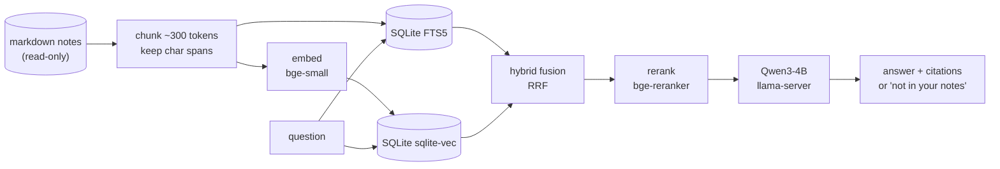

# NoteCabinet

**Privacy-focused notes assistant with fully on-device AI.** Ask questions about your markdown notes and get answers with citations, or turn a messy page into a clean, structured view. Nothing leaves your machine.

> **Status:** work in progress. The benchmark dataset (M0) and indexing (M1) are done; retrieval and Ask (M2) are next. See the [roadmap](#roadmap).

## What it does

**Ask**: answer questions about your notes, with every claim linked to the exact note and character span it came from. When the answer isn't in your notes, it says so instead of guessing.

```
> when is my discussion section now?
Wednesdays at 4pm [1]. It moved there permanently in week 3 after two earlier changes [2].
[1] 2025-10-13-patl-dsec-oh-final-slots.md:211-262
[2] 2025-10-07-patl-dsec-reschedule.md:88-140
```
*(illustrative output; the Ask feature arrives in M2)*

**Organize page**: turn one shorthand-heavy page into sections, action items and open questions, without dropping or inventing facts. Personal shorthand ("mtg w/ PATL re DSEC") is resolved by retrieving how you've used it in your *other* notes; anything still unclear is marked uncertain, never guessed. The original note is never modified.

## Why

Personal notes are private and full of shorthand only you understand. Cloud assistants need your notes to leave your machine, and generic models don't know who "PATL" is. NoteCabinet keeps everything local and treats your plain markdown files as the source of truth.

## Design decisions

1. **Raw markdown files are the source of truth.** The app never modifies them.
2. **AI output is a derived view.** Organize results are computed on request and never stored.
3. **One SQLite file holds the whole index**: FTS5 for keywords and sqlite-vec for vectors. It can be deleted and rebuilt from the notes at any time.
4. **All inference at runtime is local**: llama.cpp for the LLM, local embedding and reranker models. The app's only network call is to the local llama-server.
5. **Every answer and every organized line links back to its source** (note path + character span).

## Architecture



| Piece | Choice |
|---|---|
| LLM | Qwen3-4B-Instruct-2507 (Q4_K_M) on `llama-server` (llama.cpp, CUDA) |
| Embeddings | `BAAI/bge-small-en-v1.5` |
| Reranker | `BAAI/bge-reranker-base` (cross-encoder) |
| Index | SQLite: FTS5 (BM25) + `sqlite-vec` |
| Orchestration | LangChain core: custom retrievers over the SQLite index, LCEL chains |
| Structured output | llama-server JSON-schema constrained decoding |
| API + UI | FastAPI + one static HTML page (no CDN) |

Target hardware: a laptop RTX 4060 (8 GB VRAM) runs the LLM, embedder and reranker together.

## Evaluation

The point of this project is measuring it, not just building it. Retrieval, answers and abstention are scored on a synthetic benchmark with known ground truth.

**Ask**, reported on a held-out test split:
- **Fact-level recall@5**: did retrieval surface a note containing every fact the question needs? Plus MRR.
- **Answer correctness and faithfulness**: graded by an LLM judge whose agreement with hand grades is reported.
- **Abstention precision / recall** on unanswerable questions.
- **Ablation**: BM25 vs. dense vs. hybrid vs. hybrid + rerank, broken down by question type.
- **Latency**: p50/p95 for retrieval, reranking and generation.

**Organize**, with vs. without retrieval:
- **Coverage** of the page's ground-truth facts, **hallucination rate**, and **shorthand accuracy**.

Every eval run writes a timestamped folder under `results/` with its full config (models, thresholds, git commit, data hash) so each number is reproducible. Results will appear here once M3/M4 are complete.

## Benchmark dataset

All data is synthetic, built around a world bible for one fictional grad-student quarter.

| | |
|---|---|
| [`data/bible.md`](data/bible.md) | Ground truth: 102 dated facts (9 change over time) and a 22-entry personal shorthand glossary |
| [`data/notes/`](data/notes/) | 100 messy notes (lectures, meetings, project logs, todos, readings, ideas) |
| [`data/eval/qa.jsonl`](data/eval/qa.jsonl) | 61 hand-checked questions: single-fact, multi-fact, temporal, shorthand and unanswerable; 10 dev / 51 test |
| [`data/eval/organize/`](data/eval/organize/) | 20 messy pages with their clean facts and shorthand as ground truth (+3 dev pages) |

How it was made: the bible was drafted with Gemini and then edited by hand to fix inconsistencies. Notes, questions and pages were generated from it with Claude. Glossary abbreviations were substituted by code (so the shorthand ground truth is exact), and a seeded noise pass added typos and dropped punctuation without touching dates, numbers or names. Every question was validated in code and then checked by hand. Claude is used only offline, for the dataset and as the eval judge; the app itself never calls it. The generation scripts are not included in this repository, so evals are reproducible from the committed data.

## Roadmap

| | Milestone | Status |
|---|---|---|
| M0 | Synthetic benchmark dataset | ✅ |
| M1 | Indexing: chunking with exact spans, SQLite FTS5 + sqlite-vec, incremental re-index | ✅ |
| M2 | Retrieval (BM25 / dense / hybrid / rerank) + Ask with citations and abstention | 🚧 |
| M3 | Ask evaluation: recall, correctness, abstention, ablation, latency | |
| M4 | Organize page + evaluation, with vs. without retrieval | |
| M5 | Demo UI, results, write-up | |

Beyond the mini version: sync across devices, Android client, and tiered inference across devices.

## Running it

Requires Python 3.11+, [uv](https://docs.astral.sh/uv/), an NVIDIA GPU, and a CUDA build of [llama.cpp](https://github.com/ggml-org/llama.cpp)'s `llama-server`.

```bash
uv sync
uv run python scripts/download_models.py          # one-time: embedder, reranker, Qwen GGUF
llama-server -m models/Qwen3-4B-Instruct-2507-Q4_K_M.gguf -ngl 99 -c 8192 --port 8080
uv run python scripts/smoke_test.py               # checks sqlite-vec, FTS5, CUDA, llama-server, tracing off
```

Build the index (one SQLite file at `index/notes.db`, rebuildable at any time):

```bash
uv run notecabinet index data/notes            # incremental: only changed notes are re-embedded
uv run notecabinet index data/notes --full     # rebuild from scratch
uv run pytest                                  # span + incremental-indexing tests
```

```
full (--full): 100 notes, 139 chunks in 5.0s -> index/notes.db
incremental: 100 notes (0 new, 0 changed, 0 deleted, 100 unchanged), 0 chunks embedded in 0.0s -> index/notes.db
```

Indexing reads notes and never writes them. Each chunk is embedded with its note's title and date as context, and stores a `(start, end)` span into the raw file, so citations highlight the exact source text. Changing the chunker or embedding model triggers a full rebuild automatically.

Coming with M2: `uv run notecabinet ask "..."`.

## Repository layout

```
notecabinet/   the app package: config, CLI, index.py (read/chunk/embed/index), db.py (SQLite schema)
               retrieval, ask and organize coming
scripts/       smoke test, model download
tests/         pytest suite (spans, incremental indexing)
data/          bible, notes, eval sets
```
